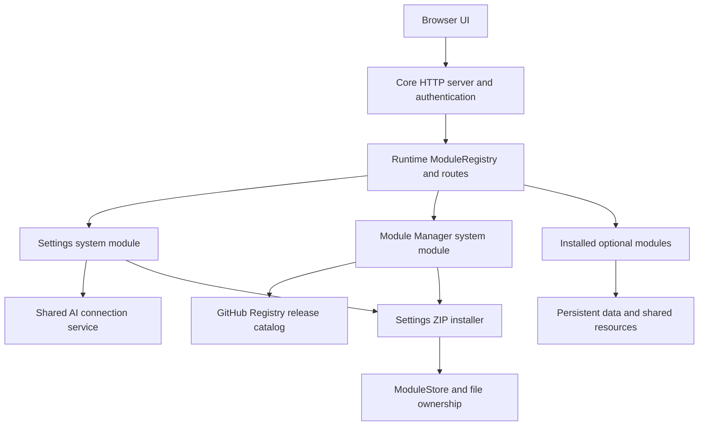

# CyberHub Architecture

Technical baseline verified on **9 October 2026**, against active source, manifests, local release archives, and GitHub repository/release metadata. This is the reference for developers and coding agents working across the ecosystem. Source remains authoritative when it changes; versions and verification results below are dated observations.

## Contents

- [Scope and repository baseline](#scope-and-repository-baseline)
- [Core components](#core-components)
- [Module contract and lifecycle](#module-contract-and-lifecycle)
- [Module identities](#module-identities)
- [Settings and Module Manager](#settings-and-module-manager)
- [Catalogs and package management](#catalogs-and-package-management)
- [Module dependencies and integration contracts](#module-dependencies-and-integration-contracts)
- [Persistence, metadata, and resources](#persistence-metadata-and-resources)
- [Shared AI connections and compatibility](#shared-ai-connections-and-compatibility)
- [Platforms and deployment](#platforms-and-deployment)
- [Design constraints and known findings](#design-constraints-and-known-findings)
- [Change impact and validation](#change-impact-and-validation)

## Scope And Repository Baseline

CyberHub is a local Python HTTP application with browser interfaces and independently released modules. It is maintained across **18 active repositories**, each with its own Git history. All 18 were public, unarchived, and on `main` at verification; each local HEAD matched GitHub `main`. The shared workspace is `/Users/cyberdelia/Documents/GitHub-CyberHub`, which is not itself a Git repository.

The active Core checkout contains only Settings and Module Manager under `modules/`. Optional sibling repositories are source repositories: simply editing a sibling checkout does not make the running Core discover it. Deployment places module code under the target installation's `modules/<id>/`, with resources at package-defined locations. The published Core 1.4.2 starter additionally includes Gallery **1.2.14**; the Registry offers Gallery **1.2.16** independently.

Addition on **15 October 2026**: `tools/build_full_bundle.py` creates a local, native Full Bundle for fresh installations. It combines current Core runtime source (including approved uncommitted runtime changes) with all official modules from local release ZIPs whose size/SHA-256 match the Registry. Every tracked module runtime/resource file must also match its sibling source repository; missing archives, source/catalog/version mismatches, unexpected paths and conflicting shared files fail the build. Module package manifests are replaced by one Hub package manifest; component versions, channels, commits, dirty-source state and source artifact digests are retained in `resources/bundle.json`. Module licenses/notices are included. The bundle retains all IDs and update behavior, includes the official Danbooru/Upscaler assets, and leaves the Gallery Auto Tagger model as a user-triggered download. It contains no interpreter, virtual environment or user data. It is separate from both the minimal starter and the Core-only updater, and must not be imported as an in-place system update. This does not revive the historical Full repository.

| Repository | Verified version/release | HEAD prefix | Responsibility |
| --- | --- | --- | --- |
| [CyberHub](https://github.com/cyberdeliaAI/CyberHub) | Core `1.4.2`; Settings `1.5.2`; Module Manager `1.1.0` | `34461a167fa7` | Server, framework, settings, shared helpers, system updates and module management |
| [CyberHub-Registry](https://github.com/cyberdeliaAI/CyberHub-Registry) | `v2026.10.06` | `cd5644577470` | Published module catalog and artifact integrity metadata |
| [CyberHub-Gallery](https://github.com/cyberdeliaAI/CyberHub-Gallery) | `1.2.16` | `418a01c774be` | Image indexing, thumbnails, metadata, search, tags, collections and prompt export |
| [CyberHub-Viewer](https://github.com/cyberdeliaAI/CyberHub-Viewer) | `1.2` | `edc181879ad3` | Browser-selected image inspection and downloadable metadata edits |
| [CyberHub-Compare](https://github.com/cyberdeliaAI/CyberHub-Compare) | `1.0` | `ba24227b84ed` | Gallery image comparison and metadata differences |
| [CyberHub-Captioner](https://github.com/cyberdeliaAI/CyberHub-Captioner) | `1.7.1` | `03c54ed2c604` | Vision-model captions, caption exports, and Library-backed presets |
| [CyberHub-Auto-Tagger](https://github.com/cyberdeliaAI/CyberHub-Auto-Tagger) | `1.0.7` | `639e48b30fcb` | Gallery-integrated WD-EVA02 ONNX tagging and searchable scores |
| [CyberHub-LoRA-Info](https://github.com/cyberdeliaAI/CyberHub-LoRA-Info) | `1.0.3` | `5339c020f7c7` | Safetensors metadata, training tags, tensor and hash inspection |
| [CyberHub-Civitai-Browser](https://github.com/cyberdeliaAI/CyberHub-Civitai-Browser) | `1.1.1-beta` | `b9db39d983ca` | Civitai model browsing and downloads |
| [CyberHub-Civitai-Grabber](https://github.com/cyberdeliaAI/CyberHub-Civitai-Grabber) | `1.1.1` | `e75c30a8e3fc` | Subprocess-backed Civitai image downloader |
| [CyberHub-Cropper](https://github.com/cyberdeliaAI/CyberHub-Cropper) | `1.2` | `379154397f9d` | Browser/host image cropping, resizing, rotation and batch output |
| [CyberHub-Danbooru](https://github.com/cyberdeliaAI/CyberHub-Danbooru) | `1.0` | `94a08787caec` | Tag lookup, prompt building, and optional browser ONNX tagging |
| [CyberHub-Amateur-Photo](https://github.com/cyberdeliaAI/CyberHub-Amateur-Photo) | `1.0` | `058108bf672d` | Local image effects using Pillow, NumPy and OpenCV |
| [CyberHub-Overlay](https://github.com/cyberdeliaAI/CyberHub-Overlay) | `1.0` | `bc44276d5d08` | Image labels, metadata captions and watermarks |
| [CyberHub-Prompt-Engineer](https://github.com/cyberdeliaAI/CyberHub-Prompt-Engineer) | `1.4.0` | `9a5734ede3b6` | Prompt generation/rewrite, static interface and prompt resource catalog |
| [CyberHub-Prompt-Library](https://github.com/cyberdeliaAI/CyberHub-Prompt-Library) | `1.0` | `19eab21e9c9f` | Prompt cards, tags, presets, notes, attachments and import/export |
| [CyberHub-Meta-Copy](https://github.com/cyberdeliaAI/CyberHub-Meta-Copy) | `1.0` | `24b605d3f715` | PNG metadata restoration for processed images |
| [CyberHub-Upscaler](https://github.com/cyberdeliaAI/CyberHub-Upscaler) | `1.1.1-beta` | `5f078b30a05c` | Local tiled ONNX image upscaling with provider fallback |

All 16 current module manifests declare minimum Core `1.3.0`; Compare and Auto Tagger declare Gallery as a dependency. Browser and Upscaler use the beta channel and GitHub prereleases; other modules are stable. Settings and Module Manager are bundled system components, not additional repositories. Some modules inherit `Module.version = "1.0"`; do not assume every class declares its own version.

Historical scope: public, archived [CyberHub-Lite](https://github.com/cyberdeliaAI/CyberHub-Lite) and private, unarchived `CyberHub-Full` contain older Core 1.2.6. Lite's README states that Lite and Full were consolidated into active CyberHub. Full is a historical source reference by architectural assessment, even though GitHub has not marked it archived. Neither is the current development base. `_build/`, `_release-assets/`, and `_test-builds/` are generated/archive directories, not repositories.

The **15 October 2026** release line uses **Core 1.5.0 / Settings 1.6.0 / Module Manager 1.1.1**. The owner authorized GitHub publication of the **Lite starter, system updater, two module notice patches and Registry**, and will publish the **Full Bundle on Civitai** separately. The GitHub system updater serves either distribution's Core while preserving optional modules; official module checks retain their Registry behavior. Fresh-install bundles carry `fresh_install_only` in their manifests and root markers outside older import allowlists (`FULL-BUNDLE.json` / `LITE-BUNDLE.json`), so current and older importers reject them before file replacement. The separate system updater contains no optional modules and has no fresh-install marker. Danbooru 1.0.1 and Upscaler 1.1.2-beta are notice/license patches with unchanged model assets and behavior. The owner's refreshed Civitai model export dated 15 October is shared by both distributions.

Model provenance verified on **15 October 2026**: bundled Danbooru FP16 weights match the upstream LFS SHA-256 from `mmmm3/danbooru-autotagger-onnx` at revision `d777ba70d4611d234dbc7cf18f7da41c5381f728`, declared MIT. Its 5,501 output labels match Danbooru Autotagger's ordered tag list. `resources/provenance/` records weights/label hashes and prompting-guide ownership; the owner confirmed that both prompting-guide PDFs are original Cyberdelia works. The bundle includes the upstream Danbooru MIT and Real-ESRGAN BSD texts. The builder verifies all referenced asset hashes before packaging.

## Core Components

| Source | Main responsibilities and contract anchors |
| --- | --- |
| [hub.py](hub.py) | `Hub`, `load_modules`, launch configuration, instance lock and threaded HTTP server; `Hub.VERSION` |
| [core/__init__.py](core/__init__.py) | `Module`, discovery, class selection, `ModuleRegistry`, identity helpers |
| [core/server.py](core/server.py) | Persistent `Settings`, `build_shell`, shared CSS/JavaScript, `HubHandler`, authentication, response/body helpers, shared file/metadata utilities |
| [core/metadata.py](core/metadata.py) | Embedded/sidecar metadata extraction, format detection and normalized generation parameters |
| [core/civitai.py](core/civitai.py) | `CivitaiLookup`, checkpoint hash lookup using `resources/civitai/models.json` |
| [core/ai_connection.py](core/ai_connection.py) | Shared/custom OpenAI-compatible connection resolution, validation and credential filtering |
| [core/module_store.py](core/module_store.py) | Installed module records, file ownership, adoption and removal |
| [core/update_notifications.py](core/update_notifications.py) | Optional background release checks and persistent local notification results (working-tree addition, 12 October 2026) |
| [core/help.py](core/help.py) | Shared help overlay |
| [modules/settings/__init__.py](modules/settings/__init__.py) | Configuration, browsing, AI endpoints, diagnostics, system release catalog and ZIP import machinery |
| [modules/module_manager/__init__.py](modules/module_manager/__init__.py) | Local module inventory, external Registry refresh, compatibility checks, module download/install/remove jobs |

`Hub` passes a common context to modules: `settings`, `registry`, `ai_connection`, `civitai`, `module_store`, `resources_dir`, `data_dir`, `is_container`, and runtime server information. `resource_path(*parts)` resolves below the installation's `resources/`; `data_path(*parts)` resolves below persistent user data. `settings_dir` is a compatibility alias for `data_dir`, and `civitai_lookup(parsed)` delegates to the lookup service. Preserve these aliases for older module code.

The server uses Python's threaded HTTP server rather than a separate web framework. Requests and module background workers can overlap. A process lock prevents simultaneous normal Hub instances using the same data directory; it is not a replacement for database/thread synchronization.

Loopback clients bypass the Hub access-token check. Non-loopback access uses the configured token through supported cookie/query/Bearer mechanisms. File browsing also has explicit local/authenticated-remote policy. Authentication and installation eligibility are separate: a valid token does not satisfy a loopback-only installer endpoint. Preserve this distinction when changing LAN or Docker behavior.

## Module Contract And Lifecycle

A discoverable module is a directory `modules/<folder>/` containing `__init__.py` that exports a `Module` subclass. Discovery sorts folder names, imports each package, and chooses the first exported subclass in `dir(pkg)` order. Discovery imports packages **before** checking enablement, so disabled modules can still have import-time effects or fail because a dependency is missing. Avoid multiple exported subclasses or side effects merely to support discovery.

The interface is defined in `core/__init__.py`:

| Interface | Contract |
| --- | --- |
| Class attributes | `name`, `version`, `release_stage`, `icon`, `description`, `order`, `show_in_tabs`, `settings_schema` |
| `__init__(hub)` | Receive the shared Hub context |
| `key()` | Runtime registry/settings identity; default is lowercased display name with spaces replaced by underscores |
| `routes_get()` | Map exact path to callback `(handler, qs)`; `qs` comes from `parse_qs`, so values are lists |
| `routes_post()` | Map exact path to callback `(handler, content_len, content_type)` |
| `prefix_routes()` | Map GET prefix to callback `(handler, remaining_path)`; suffix is URL-decoded |
| `on_startup()` | Called immediately after this instance is registered, with settings already available |
| `on_settings_changed(key, value)` | Callback for settings UI changes; default is a no-op |
| `setting(key, default=None)` | Read settings through runtime `key()`, using schema defaults before the explicit fallback |

`load_modules` adopts importable folders into `ModuleStore`, skips disabled optional modules, then instantiates, registers, and calls `on_startup`. The published 1.4.2 loader uses the class-display-name key. The 1.5.0 implementation resolves stateless `key()` overrides without calling constructors, checks the runtime key's explicit enablement preference first and falls back to the old class key when no runtime preference exists. Settings and Module Manager are always enabled. Failures are logged and loading continues; registration/startup does not roll back already added registry entries or routes.

Registration checks duplicate exact GET paths, POST paths, and identical prefixes within their respective tables. Exact GET routes precede module prefix routing; Core also reserves handlers such as `/fonts/` and `/onnx/`. Unique declared route keys do not establish that prefix overlaps or Core-reserved paths are safe. Visible tabs sort by `order` and name. Compare deliberately sets `show_in_tabs = False` and is opened from Gallery.

There is no general dependency graph scheduler or module shutdown/hot-unload callback in this interface. Startup order is folder order, not navigation order. Installation, removal, and enablement changes require a restart to change the running module set; settings may update immediately only where a module implements that behavior. Auto Tagger's lookup of Gallery works with the current folder ordering but is not a topological-loading guarantee.

Shared handler helpers include `respond_html`, `respond_json`, `respond_binary`, `serve_file`, `read_body_json`, and `parse_multipart`. Core counts/drains unread POST body bytes to preserve request handling. Most module UIs use `build_shell`; Gallery directly consumes Core shell internals including `_BASE_CSS`, `_BASE_JS`, and `_font_links`. These nominally private names therefore have existing cross-repository consumers.

## Module Identities

Package IDs, folder names, display names, runtime keys, settings keys, and route spellings are not interchangeable. The current manifest ID equals the installation folder for each official module. Core's `module_key_from_class()` remains a backwards-compatible name-derived helper. The 1.5.0 implementation adds `module_runtime_key_from_class()` for internal loading/inventory decisions; it calls `key()` on an uninitialized object without running `__init__`, and falls back to the legacy class key if the override needs initialized state.

| Package ID / folder | Runtime `key()` | Display name | Class-derived enablement key |
| --- | --- | --- | --- |
| `gallery` | `gallery` | Gallery | `gallery` |
| `viewer` | `viewer` | Viewer | `viewer` |
| `compare` | `compare` | Compare | `compare` |
| `captioner` | `captioner` | Captioner | `captioner` |
| `gallery_auto_tagger` | `auto_tagger` | Auto Tagger | `auto_tagger` |
| `lora_info` | `lora_info` | LoRA Info | `lora_info` |
| `civitai_browser` | `civitai_browser` | Civitai Browser | `civitai_browser` |
| `civitai_grabber` | `grabber` | Civitai Grabber | `civitai_grabber` |
| `cropper` | `cropper` | Cropper | `cropper` |
| `danbooru` | `danbooru` | Danbooru | `danbooru` |
| `amateur_photo` | `amateur-photo` | Amateur Photo | `amateur_photo` |
| `overlay` | `overlay` | Overlay | `overlay` |
| `prompt_engineer` | `prompt-engineer` | Prompt Engineer | `prompt_engineer` |
| `prompt_library` | `library` | Library | `library` |
| `tools` | `tools` | Meta Copy Tool | `meta_copy_tool` |
| `upscaler` | `upscaler` | Upscaler | `upscaler` |

System identities are `settings` and `module_manager`. The `CyberHub-Meta-Copy` repository intentionally ships folder/package `tools`; `CyberHub-Prompt-Library` ships `prompt_library` but registers as `library`. Auto Tagger similarly ships `gallery_auto_tagger` but registers as `auto_tagger`. Existing routes also preserve aliases such as `/auto_tagger` and `/auto-tagger`.

Preserve all established identities unless a requested change explicitly includes migration of persisted settings, ownership records, catalogs, routes, navigation and consumers. The four runtime/class mismatches caused the published enablement/status bug described below. The 1.5.0 correction preserves those identities and legacy enablement preferences; it does not rename or bulk-migrate settings.

## Settings And Module Manager

`Settings` in `core/server.py` stores JSON under the data directory and writes through a temporary file plus `os.replace`. Module settings use their respective keys, schema defaults, and enabled-by-default behavior. Settings renders configuration for loaded modules, protects both system modules, and calls settings-change callbacks where appropriate. `_api_module_toggle` writes the requested module key and reports that a restart is required.

Settings supplies system diagnostics, filesystem browsing, AI connection management, manual Core update checking/installing, and local ZIP import. Keep browsing/path exposure and credential handling consistent with existing authentication and local-access rules.

Addition in **1.5.0**, verified **15 October 2026**, for issue #3: GET `/api/system/info` adds `python_executable`, `gpus` (all detected adapters), `onnx_runtime` (import/query status, version, available providers and errors), and `auto_tagger` (module/session state, requested provider, active session provider, session providers and errors). The existing `gpu` string is retained, joining multiple names with semicolons. Linux includes VGA, 3D and display controllers; Windows retains WMIC detection with a PowerShell CIM fallback; macOS includes every reported chipset. Identical adapter names are retained as separate devices.

Settings reads the running `auto_tagger` module's existing `_tagger._session.get_providers()` in place, without calling `_get_tagger()` or `_runtime_status()`: the latter predicts availability before a session exists. A missing module or unloaded session is explicit; the requested provider is never presented as actual execution. These optional private attributes are read defensively for older module compatibility. Diagnostics does not preload CUDA, create a session, download resources or run inference. Provider availability and session provider order do not prove that GPU kernels executed successfully; a real tagging job remains necessary. Both the Settings panel and its copied text report include these fields, independently of Danbooru's browser ONNX assets.

Addition developed on **12 October 2026**, included in **1.5.0**: `UpdateNotifications` provides opt-in release checks, not automatic installation. `updates.automatic_check` defaults to false. After module loading, cached catalog data is revalidated/restored and a background check starts only if enabled and due. Enabling the preference also checks if due. Each source's last attempt is persisted to limit automatic checks to once per 24 hours, including failed attempts; an explicit manual check bypasses this limit. A disabled preference prevents subsequent automatic requests. There is no recurring remote-check timer during an already running session.

GET `/api/updates/status` only reads local results and compares installed versions. POST `/api/updates/check` starts an explicit combined check; it and preference changes require loopback. Existing manual system/module checks also refresh the saved results. The shared shell/menu reads local status to display a quiet badge and links to Settings/Module Manager; this also works with Gallery's existing shared imports. Previously installed versions awaiting restart suppress completed-update notices. Stable installations are not notified about beta catalog entries unless the installed module is already beta. Incompatible updates identify their minimum Core requirement.

Results are stored in `data_dir/update-notifications.json`, with separate successful-check dates, last-attempt dates and errors for system/module catalogs. Failed requests preserve previous results. Startup/UI rendering never waits for a GitHub response, and no ZIP download, installation, restart or dependency installation is triggered by notifications. The existing validated release/catalog readers are reused. The 9 October inventory and test counts elsewhere remain historical snapshots; these notification features are included in Core 1.5.0.

Module Manager separates installed inventory from the remote catalog. `_installed()` uses importable discovered classes and ownership records; a managed record can show newly installed version metadata before the old runtime is restarted. Import failure can make a folder absent from that inventory. Published 1.4.2 uses the class-derived key for enabled status; the 1.5.0 implementation uses the resolved runtime key consistently with the registry and Settings inventory.

The catalog is cached in the running Manager instance; refreshing explicitly fetches it. Install/update runs as a background job with progress and a Manager operation lock. Install and removal endpoints require loopback clients. System update installation and manual package import in Settings also require loopback clients. The two system modules delegate to the same ZIP installer, but their job locks should not be assumed to form one global transaction coordinator.

## Catalogs And Package Management

### Two Different Catalogs

The external [CyberHub-Registry catalog](https://github.com/cyberdeliaAI/CyberHub-Registry/blob/main/cyberhub-registry.json) is release metadata, not a Python module and not the in-memory `ModuleRegistry`. Module Manager fetches `/repos/cyberdeliaAI/CyberHub-Registry/releases/latest`, requires a stable published release, locates `cyberhub-registry.json`, and validates its GitHub SHA-256 digest and JSON. The catalog is limited to 2 MiB; module downloads are bounded separately.

Registry schema 1 identifies product/repository/generation time and module entries with ID, name, summary, version, minimum Core, repository, publisher type, channel, dependency IDs, Python requirements, asset filename, download URL, SHA-256, and size. Validation checks identities, allowed publisher/channel values, repository/download shape, dependency lists, and integrity metadata. `official`/`community` publisher and `stable`/`beta` channel are separate dimensions.

Settings reads Core release `cyberhub-update.json` instead. `_release_catalog()` rejects drafts/prereleases, verifies the catalog asset digest, matches catalog release version to the GitHub tag, and matches each package hash to its GitHub asset digest. Core 1.4.2's catalog lists one `hub` package, ID `cyberhub`, pointing to `cyberhub_update_v1.4.2.zip`. The separately named starter is for clean setup and can contain optional module versions that lag the Registry.

### Online Install And Update

1. Refresh the relevant catalog. Module Manager compares versions and minimum Core, and requires declared dependency IDs in its importable installed inventory.
2. Download the selected release ZIP, check expected size/digest, and invoke Settings `_install_import_zip(..., require_manifest=True, expected_package=...)`.
3. Read exactly one supported `cyberhub-package.json` at the ZIP root or under `resources/`. Schemas 1 and 2 are accepted by the current parser. Validate product/type/ID/version and compare **type, ID, version, and minimum Core** with catalog expectations; enforce the running Core minimum.
4. Plan allowed files, reject traversal/symlink/duplicate/size/count problems, and enforce online package scope. A module must include `modules/<id>/__init__.py`. Official packages may write their own module folder plus `resources/` and `licenses/`; community packages are restricted to their module folder and `resources/modules/<id>/`.
5. Stage files below installation `updates/tmp/`, compile staged Python, and back up all existing destination files before replacing any live file. Replace files individually with `os.replace`; on replacement failure, attempt to restore touched files.
6. Record installed module metadata and the union of previous/new owned files, retain backups below `updates/backups/`, and request a restart.

The installer does not compare every manifest field with its catalog: repository, publisher, channel, dependency declarations and resource ownership still need release review. Official packages can collide in shared resource paths. Hash validation identifies the expected bytes; imported Python still runs with the Hub process's privileges, without a module sandbox.

Update is replacement of supplied files, not directory synchronization. Files absent from a newer ZIP remain. The process uses atomic replacements per file and best-effort rollback, not a guaranteed transaction across all files, ownership metadata, and running workers. It does not hot-reload modules or automatically remove Python packages.

### Manual ZIP Import

Settings `_api_import_package()` requires loopback and accepts a multipart ZIP. It uses the same file planner/staging machinery with `require_manifest=False`, supports additional source/convenience layouts, and can import packages without a manifest. Even if a manifest is present, the online catalog comparison/minimum/scope checks are not the same path. Treat manual import as a distinct operation; do not claim it gives the same identity, compatibility, or ownership guarantees as online installation.

Blocked runtime/user paths include `settings.json`, `.cyberhub.lock`, database/WAL files, virtual environments, repository internals and bytecode. Allowlisted root files and `core/`, `modules/`, `resources/`, `licenses/` define importable source. Package manifests are metadata, not installed runtime files. Root `AGENTS.md` and this architecture reference are not in Core 1.4.2's root import allowlist; they are source documentation, not automatically delivered by its updater.

### Ownership And Removal

`ModuleStore` persists `installed-modules.json` in `data_dir`. Discovery adopts already-present modules with `managed: false` and does not claim shared resources. Online/manifest-backed installation records owned files with `managed: true`. Settings and Module Manager are protected from removal and disablement.

Removal backs up recorded files, checks that real paths remain inside the installation, deletes only the applicable owned files, and attempts restoration on failure. For unmanaged modules, it restricts removal to `modules/<id>/`. It removes empty directories and updates the ownership record, then requires restart. Generated/unowned user data, thumbnails, Library content and separately downloaded models are not automatically removed. There is no reverse-dependency uninstall guard; consider Gallery consumers before removing Gallery. Shared-resource ownership conflicts need manual review.

For publishing order, artifact construction, checksum/download verification and compatibility gates, consult the workspace `GITHUB-PUBLISHING-CHECKLIST.md`. In the shared workspace it is one directory above this repository; a standalone clone may not include it.

## Module Dependencies And Integration Contracts

Formal manifest dependencies describe only part of the runtime coupling. Inspect routes, registry lookups, imports, SQL and resources before changing a component.

| Producer / dependency | Consumer | Actual integration |
| --- | --- | --- |
| Gallery | Compare | Formal dependency `gallery`; browser fetches `/api/metadata?path=...` and `/image/<encoded-path>`. Compare displays 2–4 images and is launched from Gallery. Preserve repeated path parameters and legacy comma-separated input handling. |
| Gallery | Auto Tagger | Formal dependency `gallery`; `on_startup` gets runtime `gallery`, shares its DB/lock, reads `files`, and uses private `_get_conn`, `_metadata_filter_sql`, and `_file_dict` helpers. |
| Auto Tagger | Gallery | Gallery checks runtime `auto_tagger` for optional tagging integration. Preserve its table/score conventions and UI/filter behavior. |
| Library | Gallery | Optional browser integration uses Library card/attachment APIs to save prompts and source images. Gallery remains usable without Library. |
| Library | Captioner | Optional runtime `library` lookup; saved preset endpoints return 503 when unavailable. Caption generation itself has no formal Library dependency. |
| Core metadata/Civitai/shell | Many modules | Shared imports, normalized metadata, lookup helpers, handler methods, UI chrome and resource routes |
| Core shared AI service | Captioner and Prompt Engineer | Optional service use with existing custom-connection and older-Core fallbacks |

**Gallery and Auto Tagger:** Gallery starts its database/indexing infrastructure before Auto Tagger's startup under the current folder order. Auto Tagger stays idle when Gallery or its DB is unavailable. It adds `auto_tagger_files`, `auto_tagger_scores`, `auto_tagger_catalog`, and `auto_tagger_config` tables and cleanup behavior in the shared database. This is direct SQL/private-method coupling, not an independent tagging microservice. Schema, path identity, lock, filter and returned file-dictionary changes require tests in both repositories.

**Library and Captioner:** the installed package is `prompt_library`, while both Python lookups and browser endpoints use `library`. Captioner uses Library `list_cards`, `get_card`, `create_card`, `update_card`, and `delete_card`; it includes paginated results and legacy tagged presets. Current presets use type `captioner` and tag `captioner-preset`. Preserve older cards and attachments when changing preset workflows. Prompt Engineer's browser generation preferences are a separate mechanism, not a formal dependency on Library.

### Selected Payload Contracts

| Interface | Existing payload expectations |
| --- | --- |
| Gallery `_file_dict` | `path`, `name`, `folder`, `ext`, `size`, `mtime`, `width`, `height`, boolean `has_metadata`/`favorite`, and `processing`; optional model information is added separately. Auto Tagger reuses this serializer and its positional SQL row layout. |
| GET `/api/metadata?path=...` | Gallery metadata object, including normalized `parsed` data and Civitai enrichment where available; may return an empty object. Treat Gallery path identifiers as opaque and preserve URL encoding. |
| POST `/api/gallery/export-prompts` | JSON `{ "paths": [...] }`; returns `text`, `exported`, `skipped`, and `pending`. Exports stored positive prompts, rather than re-reading every image synchronously. |
| GET `/api/library/cards` / `list_cards` | Pagination envelope `total`, `offset`, `limit`, `cards`; card fields include ID/title/type/target/content/negative/notes/tags, source fields and attachment metadata. Consumers must paginate rather than assume one response contains all cards. |
| POST `/api/library/card` and related update/delete routes | Card creation returns `ok` and `id`; update/delete use the existing ID. Gallery's attachment upload and card creation are separate requests. Preserve card and attachment identities across consumers. |

These are selected cross-module contracts, not a generated API specification. Check each module's `routes_get`, `routes_post`, and handler implementation for complete fields, limits and error responses before editing a caller or server endpoint.

**Other module boundaries:** Viewer consumes browser-selected files and produces downloadable metadata edits; it does not require Gallery indexing. Danbooru's browser ONNX pipeline is independent of Gallery Auto Tagger. Civitai Browser uses shared Civitai credentials and model downloads; Grabber runs the vendored `resources/civitai-grabber/civit_image_downloader.py` subprocess. The current Grabber UI exposes username/version modes (1/4) and does not offer every mode suggested by older broad descriptions. Cropper, Amateur Photo, Overlay and Upscaler can process host files or uploads through their own APIs; changes must preserve their output and metadata behavior. Meta Copy's `tools` identity and PNG metadata restoration remain independent of those processors.

## Persistence, Metadata, And Resources

### Data Locations

By default, native `data_dir` is the installation directory. `CYBERHUB_DATA_DIR` overrides persistent data without moving installation resources. `Hub` creates expected resource subdirectories; importing/initializing server code can create directories, so use temporary data during tests.

| Data/resource | Location and ownership |
| --- | --- |
| Settings and instance lock | `data_dir/settings.json`, `data_dir/.cyberhub.lock` |
| Shared SQLite data | `data_dir/cyberdelia.db`, with SQLite WAL/SHM side files |
| Gallery thumbnails | `data_dir/.thumbs/`, hashed WebP cache layout |
| Installed module records | `data_dir/installed-modules.json` |
| Update notification cache | `data_dir/update-notifications.json`; local metadata, not an update package |
| Library attachments | Native portable default: `resources/library/attachments/`; alternate data directory: `data_dir/library/attachments/` |
| Package source and bundled resources | Installation `modules/`, `core/`, `resources/`, `licenses/` |
| Installer staging/backups | Installation `updates/tmp/` and `updates/backups/` |
| User image/model collections | User-configured host/container folders; not implicitly moved into `data_dir` |

Gallery owns image tables including `files`, `folders`, `tags`, `file_tags`, `collections`, and `file_collections`. Its writer connections are thread-local and use WAL, a busy timeout, and coordination locks. Read operations use separate short query-only snapshot transactions so background writers can continue. File discovery queues metadata/thumbnail work; filesystem watching and background cleanup overlap with browser reads. Thumbnail paths use an MD5-derived shard and WebP filename, so consumers must preserve path/hash conventions.

Gallery **1.2.17**, developed on **21 October 2026** for issue #4: the explicit `Generate All Thumbs` database pass decodes current cached WebPs before reusing them. Missing, stale, empty or unreadable thumbnails are atomically regenerated under the existing per-thumbnail lock; original images are only decoded when regeneration is needed. Normal HTTP thumbnail requests keep their existing timestamp/size fast path. The cache layout, database rows, original image files and cross-module APIs are unchanged. A browser force-refresh may be needed after repair because the thumbnail URL still uses the source mtime.

Library opens the **same database file**, but owns `prompt_cards`, `prompt_tags`, and `prompt_card_tags`, with its own connection and lock. It does not require Gallery to exist. Auto Tagger accesses the Gallery connection and lock rather than establishing a separate schema owner. WAL does not make arbitrary multi-module SQL changes automatically compatible; preserve table ownership, short transactions and safe locking.

Library JSON export references attachments; ZIP export carries referenced attachment bytes. Database backup alone is therefore insufficient for a complete portable Library backup. Native attachments may live under installation resources even though the DB uses `data_path`; preserve both locations during migrations/updates.

### Metadata Contract

`core/metadata.py` extracts PNG generation text and supported embedded formats. JPEG/WebP companion `_meta.txt` has precedence before embedded extraction; PNG also has a sidecar fallback. Format handling includes ComfyUI, A1111/Forge, Civitai, InvokeAI, NovelAI, SwarmUI, Fooocus and EasyDiffusion.

`parse_sd_parameters` normalizes to `raw`, `prompt`, `negative_prompt`, and `settings`, with established setting spellings such as `Steps`, `CFG scale`, and `Model hash`. Gallery persists metadata and exports positive prompts from stored records; pending/corrupt/negative-only records have explicit export behavior. Civitai lookup consumes the normalized checkpoint model hash. Preserve raw text and normalized key spellings rather than silently imposing a new format.

Core **1.5.1**, prepared on **21 October 2026** for issue #5: A1111 settings tokenization preserves JSON arrays/objects, nested containers and escaped quotes instead of splitting their internal commas. Embedded `Civitai resources` / `civitaiResources` JSON lists supply a checkpoint fallback only when no explicit `Model` is present, and a readable `LoRAs` setting using resource names and all supplied numeric/string weights (including negative, zero and unit weights). Successfully recognized resource lists are omitted from the settings grid; their full JSON remains unchanged in `raw` / Raw Metadata. Unrecognized resource data remains visible. The existing Civitai sidecar normalization retains its version-name and unit-weight display conventions. Gallery re-parses stored generation text on metadata requests, and Viewer uses the same Core parser; this display correction requires no database migration or module-source change. Distribution is a small system patch for Core 1.5.0, with `minimum_hub_version: "1.5.0"` in its package and update catalog. It replaces only `hub.py`, `core/metadata.py`, version/release metadata and release notes; no optional module or bulk resource is included. Lite/Full 1.5.0 starters remain valid and are updated through Settings. Older installations must first apply the full 1.5.0 system updater.

Image processors use different metadata paths: Viewer rewrites PNG metadata for a new download while preserving image data; Cropper handles generation text/sidecars and image orientation; Amateur Photo, Overlay and Upscaler preserve supported metadata to the extent of their output format; Meta Copy restores textual PNG metadata. JPEG/EXIF and sidecar handling can be best-effort. Do not assume one universal lossless round trip for every format; test representative existing workflows.

### Bundled Versus Downloaded Resources

Core contains shared fonts/help, the tracked Civitai model lookup, and helper code. Some module release assets include large ONNX/data files absent from source Git. The Danbooru and Upscaler ZIPs in the verified catalog are approximately 126 MB and 62 MB; a source checkout alone does not reproduce them.

Auto Tagger downloads `model.onnx` and `selected_tags.csv` for `SmilingWolf/wd-eva02-large-tagger-v3` into `resources/auto_tagger/wd-eva02-large-tagger-v3/`, at pinned revision `b25b82a03f7282e41aa2f257a52c7583b710bd1c`. The roughly 1.3 GB model download is separate from the module ZIP. It uses local ONNX providers and CPU fallback, not the shared chat-model connection. Danbooru uses its own browser runtime/model resources; Upscaler uses local models under `resources/upscalers/`.

Prompt Engineer serves static files from its module `static/` directory and reads prompt resources recursively under `resources/prompt-engineer/prompts/`, with size/path filtering and established prompt naming/selection behavior. Shared Core `/fonts/` and `/onnx/` resource routes are consumed by interfaces outside Core.

See [DATA-ASSETS.md](DATA-ASSETS.md) for asset locations and [THIRD-PARTY-NOTICES.md](THIRD-PARTY-NOTICES.md) for distribution notices. Its builder reference is currently incomplete; see the findings below.

## Shared AI Connections And Compatibility

`AIConnection` provides centralized OpenAI-compatible configuration, commonly for LM Studio: backend, normalized HTTP(S) API URL ending in `/v1`, model, transport and optional API key. Modules opt in through `hub.ai_connection` rather than receiving a mandatory replacement for existing connections.

`resolve(module_key)` supports `shared` and `custom` modes. Existing module `api_url` values continue to imply custom mode when no explicit mode was saved; existing custom settings are not silently overridden by a new central default. Shared mode preserves the custom backup and allows a module-specific `shared_model`. Custom legacy transport can be `auto`; centrally saved transport is Hub or browser.

Hub transport makes requests from the CyberHub computer, while browser transport makes requests from the browser computer. `localhost` therefore refers to different machines under LAN use, and to the container under Docker Hub transport. Browser transport also depends on browser/network/CORS behavior; connection tests do not establish that every deployment topology works.

Settings exposes GET/POST `/api/ai/connection`, POST `/api/ai/models`, and POST `/api/ai/browser-connection`. Public configuration responses recursively omit `api_key` and expose `api_key_set`. An explicit browser-connection request returns credentials needed by that transport; do not interpret masking as a guarantee that no endpoint returns a key. Keys remain in local settings; protect those files and avoid logging them. Omitted keys survive edits only for the same normalized endpoint, and endpoint changes clear them unless explicitly supplied.

Captioner and Prompt Engineer retain older-Core compatibility checks/fallbacks for missing shared service/helper support. Captioner uses OpenAI-compatible vision chat completion requests and export workflows; Prompt Engineer includes a streaming relay. Unsupported generation parameters can trigger retries. Changes to shared resolution, model discovery, auth headers or retry behavior require both modules' integration checks, including old custom settings and intentionally unsupported old Core paths.

Shared AI configuration does not govern Auto Tagger, Danbooru or Upscaler ONNX inference. Their model/provider/runtime choices remain separate contracts.

## Platforms And Deployment

Published 1.4.2 native launchers target **Python 3.10–3.13**. The 1.5.0 launcher change on **15 October 2026** extends both launcher guards/candidate lists to **3.14**, retaining the existing preference for 3.12, then 3.11, 3.10 and 3.13 before 3.14. Native Python 3.14 verification covers Apple Silicon macOS, including a fresh dependency installation and an actual `start.sh` launch. Intel macOS has no Python 3.14 ONNX Runtime wheel: when Auto Tagger or Upscaler is present, `start.sh` selects Python 3.10–3.13 and diagnoses an existing Intel 3.14 environment before pip, unless it already contains an importable custom ONNX Runtime. Minimal installs without these Python ONNX modules retain Intel 3.14 support. Windows uses `.venv` and validates its supported Python range each run. `start.sh` accepts existing `.venv` or `venv/` and performs supported-interpreter selection when creating one; apart from the specific Intel ONNX check, it does not provide the same existing-environment validation as Windows.

Both launchers upgrade/install packages during startup, install base requirements and requirements for installed modules including disabled modules, and add CPU `onnxruntime` when Auto Tagger/Upscaler needs it and no runtime is importable. They can download fonts/resources. Do not execute them merely as a harmless syntax check. Core base requirements include Pillow, send2trash, requests and watchdog; module-specific requirements add packages such as NumPy/OpenCV or Grabber's httpx/aiofiles/tqdm/tenacity. Modules share one Python environment, so requirement changes can affect other modules. Preserve intentionally selected GPU runtimes.

The [Dockerfile](Dockerfile) builds Python 3.12 slim, installs base requirements plus ONNX Runtime, copies the build context, prepares fonts, runs as UID/GID 10001, and launches `hub.py --listen` directly. Published 1.4.2 does **not** iterate over optional module requirements. The 1.5.0 Dockerfile adds the same per-module requirements loop used by native launchers after copying module files; a native shell/requirement check does not replace a real container build/run. A fresh Core source image contains only its system modules unless the build context has additional modules.

[docker-compose.yml](docker-compose.yml) binds host `127.0.0.1:8899`, persists `/app/data` and the Auto Tagger download directory, and documents optional image mounts. It does not persist installation module code or all resources: runtime-installed code can disappear on container recreation. Upscaler/user image mounts, write permissions, and module requirements require deployment-specific planning.

Docker support is present in source and tests, but a live container was not run during the 9 October audit. The loopback installation restriction is source-confirmed; its likely effect on host-browser access through Docker bridge forwarding remains an environment-specific finding to verify. LAN authentication and filesystem browsing are intentional supported behaviors; do not bypass authentication to address container usability.

## Design Constraints And Known Findings

These classifications distinguish evidence from a hypothetical failure. No fixes are implied by documenting them.

### Published Enablement And Status Bug; Corrected In 1.5.0

For Amateur Photo, Civitai Grabber, Meta Copy Tool and Prompt Engineer, runtime `key()` differs from `module_key_from_class()`. Settings `_api_module_toggle` saves the runtime key, while `hub.load_modules` reads the class-derived key. A disabled runtime-key setting therefore does not stop these modules loading after restart. Module Manager `_installed` can also report them disabled because it checks the class-derived key against the runtime registry.

The earlier audit reproduced this using actual module classes, the Core loader and Settings toggle with in-memory settings: all four remained loaded after disabling their runtime keys. Source was rechecked for this reference. Auto Tagger and Library have different folder/runtime identities but their display-name-derived keys match runtime keys, so the same bug does not follow merely from that difference. The 15 October 2026 correction resolves runtime keys before checking enablement, uses legacy class-key preferences only when the runtime key has no explicit setting, and uses the same runtime identities in Settings/Module Manager inventories. Regression tests cover all four identities, conflicting/legacy flags, disabled constructor avoidance and protected system modules.

### Confirmed Guards, With Docker Impact Not Yet Reproduced

Module Manager `_api_install` and `_api_remove`, plus Settings system install/manual import, reject non-loopback requests with 403. Core `_is_loopback` examines the client's address, not the host-facing URL. Docker bridge forwarding can present a non-loopback address despite a host localhost URL. The guard is confirmed; a failure in the supplied Compose deployment was not demonstrated in a live container. Validate the actual topology before proposing a behavior change.

### Registration Recovery Risk

`ModuleRegistry.register` inserts the instance and then adds routes incrementally. A duplicate route or later startup failure can leave partial state; `load_modules` logs failure without unregistering it. This is a source-confirmed recovery risk, not evidence of a current production route conflict. Static inspection found no duplicate keys among 169 declared route entries in the audited source; that does not cover dynamic routes, prefix overlap or Core reservations.

### Documentation And Build Gap

`DATA-ASSETS.md` says `build_release.py` picks up external resources, but that script is absent from active Core. Historical Full contains older builders; the local `_release-assets/CyberHub/v1.4.2/build_package.py` is release-specific and uses absolute paths/older starter inputs. Captioner, Cropper and Prompt Engineer have module test-package builders. There is no verified uniform build pipeline for all 18 repositories in this baseline. Record the actual builder and inputs for each release instead of promising reproducibility from a fresh clone.

### Existing Limits Requiring Compatibility Review

- Dependency checks cover importable installed IDs, not enabled dependencies, topological startup, module version ranges or reverse-dependency removal.
- Online and manual ZIP import enforce different manifest/scope checks; official modules can share resource paths.
- Updates retain obsolete files, use best-effort rollback, and require restart; running workers are not a transactional part of file replacement.
- Native startup can update the shared Python environment; Docker startup has a different dependency path.
- Databases, attachment files, bundled assets and downloaded models have distinct locations/owners; backing up only one is incomplete.
- Source-level platform support, optional provider fallback, and mocked connection tests do not establish successful real GPU, remote server, NAS or Docker operation.

These limits are not automatically bugs. Diagnose a concrete requested workflow before changing them.

## Change Impact And Validation

| Change area | Inspect/test consumers |
| --- | --- |
| Module discovery, identity, settings or shell | All modules; especially overridden keys, system modules and Gallery's private shell imports |
| Gallery SQL, file dictionaries, metadata/image routes or thumbnails | Gallery, Auto Tagger and Compare; Gallery-to-Library actions |
| Library cards, pagination, attachments or preset schema | Library, Gallery and Captioner, including legacy cards |
| AI connection resolution, credentials, transports or retries | Core, Captioner and Prompt Engineer, including older-Core fallback paths |
| Metadata extraction/normalization or Civitai lookup | Gallery, Viewer, LoRA Info and image processors that consume shared helpers |
| Catalogs, manifests, ZIP scope or ownership | Registry, Settings, Module Manager, all relevant package builders and isolated install/update/remove flows |
| Data/resource locations or native/Docker startup | Gallery/Library persistence, model resources, native launchers and container mounts/dependencies |

Core [tests/](tests/) contains Python suites for module menus, Module Manager, Settings layout, AI connections and Docker support, plus Node browser tests for AI connections and Module Manager. Gallery, Auto Tagger, Captioner, Cropper and Prompt Engineer have Python tests; Viewer, Gallery, Captioner, Cropper and Prompt Engineer have Node tests. The other ten module repositories had no dedicated test suite in this baseline. Benchmarks are separate from ordinary unit tests and can perform substantial work.

Select safe, relevant suites in an existing authorized environment. Gallery accepts `CYBERHUB_CORE_PATH`; Prompt Engineer integration tests accept `CYBERHUB_CORE`/`CYBERHUB_CAPTIONER`; Captioner export tests accept `CAPTIONER_SOURCE`. Inspect filesystem effects before importing Hub or running Docker-support tests. Use temporary databases, images and data paths; do not launch installers or alter real collections to satisfy a routine code check.

The earlier 9 October audit checked 52 Python files by in-memory compilation and ran eight Node test files successfully. Python results included Gallery 26, Auto Tagger 32, Captioner 12 and Cropper 15 passing tests; four selected Core suites passed 30 tests with one dependency-related skip. Prompt Engineer's two Python test files were not executed because `requests` was unavailable; Docker-support tests and live container/OS/model/GPU workflows were not run. This is historical coverage evidence, not a promise that all tests passed or a reason to install dependencies automatically. The documentation-only update did not rerun those runtime suites.

When updating this reference, preserve the distinction between verified source behavior, declared compatibility, reproduced failures and untested environments. Keep operational agent instructions compact in [AGENTS.md](AGENTS.md); keep release checklists separate from architecture contracts.
